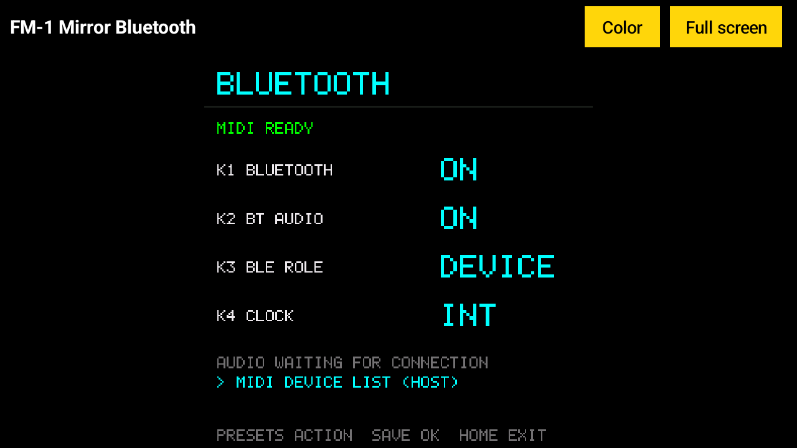

# FM-1 Mirror Bluetooth for Android

The M-VAVE FM-1's tiny 1.54-inch screen, **big on an Android tablet or phone, over Bluetooth**. No
cable to the FM-1: it can sit across the room on its battery. Just the screen, live, in colour or a
high-contrast look, full screen if you like.



It only ever uses Bluetooth, so **the FM-1's USB stays free**: another app (Synth Spyglass, a DAW,
a sequencer) can play the FM-1 over USB while this one shows its screen. On Android only one app at
a time can use the FM-1's USB.

Want to play the FM-1 from a keyboard and see your notes too? That's
[FM-1 Mirror + Spyglass](https://github.com/pfkellogg/fm1-mirror-spyglass-android), which also works
over Bluetooth. On a Mac, Windows or Linux computer: [FM-1 Mirror](https://github.com/pfkellogg/fm1-mirror).

Questions, or something not working? Write to me: **pfkellogg@gmail.com**

## Download

[**FM-1-Mirror-Bluetooth-android.apk**](https://github.com/pfkellogg/fm1-mirror-bluetooth/releases/latest/download/FM-1-Mirror-Bluetooth-android.apk)
(Android 11 or newer, with Bluetooth)

Open the link on the tablet or phone and tap the file when it has downloaded. It isn't from Google
Play, so Android asks first: allow your browser to **install unknown apps**, then tap **Install**.

> **Not the green "Code" button.** GitHub's green **Code → Download ZIP** gives the app's source
> code, which doesn't install. Use the link above, or **Releases** on the right of the page.

## First, the firmware (once)

The FM-1 sends its screen with the **FM-1 Big Screen** firmware: M-VAVE's free Official Open firmware
plus one small addition. Over Bluetooth it needs the build that came with
[FM-1 Mirror + Spyglass](https://github.com/pfkellogg/fm1-mirror-spyglass-android) 1.3 (or
[FM-1 Mirror](https://github.com/pfkellogg/fm1-mirror) 1.2) or later. Install it once, over USB, with
either of those apps: they walk you through it (and offer **Update FM-1** if the FM-1 has an older Big
Screen). This app shows **"Connected, but no screen"** when the FM-1 needs it.

## Bluetooth needs firmware with Bluetooth

This app works **only when the FM-1's firmware has Bluetooth MIDI**.

| Firmware | Big screen over |
|---|---|
| **FM-1 Big Screen** (M-VAVE's Official Open firmware + the screen) | **USB or Bluetooth** |
| **[ChoralRoot + Big Screen](https://github.com/pfkellogg/ChoralRootFM1)** | **USB only**: ChoralRoot has no Bluetooth MIDI |
| **[JIANT FM + Big Screen](https://github.com/pfkellogg/JIANT)** | **USB only**: JIANT has Bluetooth MIDI (V10.13 and later, with its **JIANT FM-1** app), but this build sends its screen over USB only |
| **[Skiff + Big Screen](https://github.com/pfkellogg/skiff)** | **USB only**: Skiff has no Bluetooth MIDI |
| **[SLOOP + Big Screen](https://github.com/pfkellogg/sloop-fm1)** | **USB only**: SLOOP has no Bluetooth MIDI |
| **[Melodee + Big Screen](https://github.com/pfkellogg/melodee)** | **USB only**: Melodee has Bluetooth MIDI, but this build sends its screen over USB only |

On firmware without Bluetooth MIDI, such as ChoralRoot, Skiff or SLOOP, this app can't find the FM-1 at all. JIANT and
Melodee have Bluetooth MIDI, but their Big Screen builds send the screen over USB only, so this app shows no screen. Use
[FM-1 Mirror + Spyglass](https://github.com/pfkellogg/fm1-mirror-spyglass-android) (Android) or
[FM-1 Mirror](https://github.com/pfkellogg/fm1-mirror) (Mac, Windows, Linux) with a USB cable instead.

## Connecting

1. On the FM-1, hold **HOME** and press **GLO**: its **BLUETOOTH** page. Turn **K1 BLUETOOTH** to
   **ON** and **K3 BLE ROLE** to **DEVICE**. It says **WAITING FOR DEVICE**.
2. Turn on Bluetooth on the tablet or phone, open **FM-1 Mirror Bluetooth** and tap **Find the
   FM-1**. **Allow** Nearby devices the first time.
3. It finds **FM1 Community_BLE** and the screen appears. From then on it connects by itself whenever
   it's open and the FM-1 is on.

The FM-1 takes **one Bluetooth connection at a time**: close FM-1 Mirror + Spyglass, or FM-1 Mirror on
a computer, if one of them is connected over Bluetooth.

## Using it

- **Color** switches looks: Color, Bright color (lifts dark colours like purple so they can be read),
  Yellow on black, White on black, Black on white.
- **Full screen**: only the FM-1's screen. Tap it to bring the buttons back.
- The screen stays on while the app is open; switched to another app, it lets go of the FM-1.

## Build it yourself

Java 17 and the Android SDK:

```
./gradlew assembleDebug
# -> app/build/outputs/apk/debug/app-debug.apk
```

## For the curious

Plain Java, Android's own MIDI, no other libraries.

- `Codec.java`: the screen messages. The app sends `F0 7D 'F' 'S' 00 F7` about once a second (`01` to
  have the whole screen sent again); the FM-1 sends each row it paints as
  `F0 7D 'F' 'S' 01 row col <runs> F7`, each run a count and an RGB565 colour. The Big Screen firmware
  answers on the connection that asked, USB or Bluetooth. Its screen part is
  [MIT licensed](https://github.com/pfkellogg/fm1_open/tree/screen-out/screen_mirror).
- `Ble.java`: finding the FM-1 over Bluetooth and opening it as a MIDI device.
- `MainActivity.java`: the connection, the hellos, and the screen.

## License

MIT (see LICENSE). © 2026 Patrick F. Kellogg. M-VAVE and FM-1 are M-VAVE's names; this app isn't an
M-VAVE product.
